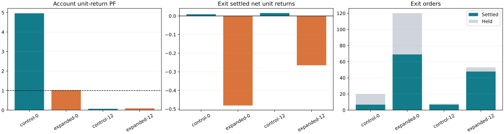
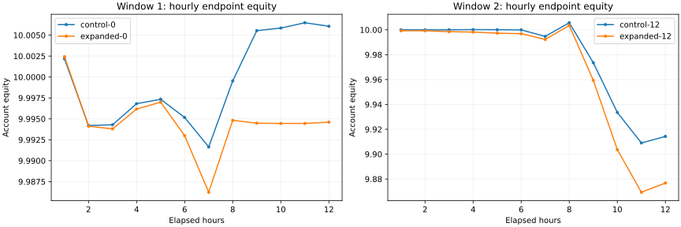

# Exit comparison results — 25 October 2026 UTC

Four audited 12-hour replays, each with 12 symbols, 150h fitting history, 1/5/15m lanes and minute pricing. These are funded modeled executions, not venue fills. Original and expanded policies share neutral sizing and admission gates. Expanded fits remain optional: they lost in both windows. Original Exit settled 14 winning orders across the windows, but most tactics lack settled samples and the account lost in the later window. This does not establish stable profitability.

Order counts are opened / settled / held; position counts are opened / closed / held. Positions can overlap across ranges or tactics and must not be added across groups. Loss-free Exit samples have no finite PF; they are not the report display sentinel 4.

| Scenario | Account PF | Equity DD | Account orders | Account positions | Exit PF | Exit orders | Exit positions | Wall seconds | Peak MiB |
|---|---:|---:|---|---|---:|---|---|---:|---:|
| control-0 | 4.9611 | 0.1313% | 445/366/79 | 14/6/8 | no-loss | 20/7/13 | 5/1/4 | 390.7 | 3560.1 |
| expanded-0 | 1.0256 | 0.1840% | 490/373/117 | 17/7/10 | 0.0423 | 120/69/51 | 9/3/6 | 651.6 | 3649.0 |
| control-12 | 0.0679 | 1.1700% | 860/278/582 | 4/2/2 | no-loss | 8/7/1 | 3/2/1 | 652.7 | 3520.9 |
| expanded-12 | 0.0898 | 1.5781% | 1150/332/818 | 13/7/6 | 0.2260 | 53/48/5 | 12/7/5 | 666.2 | 3619.1 |

Hourly results below use settled-close reporting bins; calculations still use minute prices. Cohort-boundary holdings are included by the independent position/order ledger. The coverage archive counts both directions for every config, including the ineligible opposite side of side-specific Exit IDs; those all-orientation percentages must not be presented as eligible-side percentages.

## control-0

| Exit tactic | Orders | Positions | PF | Gross unit gain | Gross unit loss |
|---|---|---|---:|---:|---:|
| static-sl | 0/0/0 | 0/0/0 | empty | 0 | 0 |
| adaptive-sl | 2/0/2 | 2/0/2 | empty | 0.000000 | 0.000000 |
| trailing | 2/0/2 | 1/0/1 | empty | 0.000000 | 0.000000 |
| breakeven | 0/0/0 | 0/0/0 | empty | 0 | 0 |
| trailing-only | 16/7/9 | 4/1/3 | no-loss | 0.009002 | 0.000000 |

| Range/type | Configs | Sources | Symbols | Configs with any Last-4 at start | All-orientation contexts Last-4 | Max SL/TP | Min trail gap |
|---|---:|---:|---:|---:|---:|---:|---:|
| type: exit | 68 | 9 | 12 | 91.18% | 31.92% | 0.6147540983606556 | 0.015774 |
| strategyRange: Exit | 68 | 9 | 12 | 91.18% | 31.92% | 0.6147540983606556 | 0.015774 |
| lane: 15 | 36784 | 118 | 12 | 78.08% | 39.72% | 3 | 0.002 |
| type: normal | 27625 | 118 | 12 | 82.16% | 32.84% | 3 | — |
| strategyRange: Signals | 126182 | 118 | 12 | 82.11% | 33.41% | 3 | 0.002 |
| lane: 1 | 45527 | 118 | 12 | 80.87% | 13.61% | 2.6785714285714284 | 0.0025 |
| type: trailing | 82645 | 118 | 12 | 81.99% | 33.49% | 3 | 0.002 |
| type: trailing-only | 15912 | 118 | 12 | 82.68% | 34.03% | — | 0.0025 |
| lane: 5 | 43939 | 118 | 12 | 86.79% | 48.66% | 2.7040816326530615 | 0.00275 |

| Hour UTC | Orders | Positions | Settled PF | Equity | Max DD so far | Exit settled |
|---|---|---|---:|---:|---:|---:|
| 10-16 21:00 | 222/26/196 | 8/1/7 | 1.6716 | 10.002178 | 0.0430% | 0 |
| 10-16 22:00 | 0/91/105 | 0/1/6 | 0.2681 | 9.994201 | 0.0958% | 6 |
| 10-16 23:00 | 0/0/105 | 0/0/6 | empty | 9.994295 | 0.1010% | 0 |
| 10-17 00:00 | 11/3/113 | 2/0/8 | 0.0000 | 9.996809 | 0.1010% | 0 |
| 10-17 01:00 | 2/21/94 | 0/0/8 | 0.0014 | 9.997341 | 0.1010% | 0 |
| 10-17 02:00 | 1/4/91 | 0/0/8 | 0.3401 | 9.995161 | 0.1010% | 0 |
| 10-17 03:00 | 42/8/125 | 4/0/12 | 0.0742 | 9.991639 | 0.1185% | 1 |
| 10-17 04:00 | 113/118/120 | 0/2/10 | 13.6376 | 9.999540 | 0.1313% | 0 |
| 10-17 05:00 | 54/69/105 | 0/1/9 | 28.4980 | 10.005544 | 0.1313% | 0 |
| 10-17 06:00 | 0/22/83 | 0/0/9 | no-loss | 10.005851 | 0.1313% | 0 |
| 10-17 07:00 | 0/4/79 | 0/1/8 | no-loss | 10.006484 | 0.1313% | 0 |
| 10-17 08:00 | 0/0/79 | 0/0/8 | empty | 10.006066 | 0.1313% | 0 |

## expanded-0

| Exit tactic | Orders | Positions | PF | Gross unit gain | Gross unit loss |
|---|---|---|---:|---:|---:|
| static-sl | 5/5/0 | 2/2/0 | 0.0000 | 0.000000 | 0.033678 |
| adaptive-sl | 9/7/2 | 5/3/2 | 0.0000 | 0.000000 | 0.054947 |
| trailing | 35/17/18 | 7/2/5 | 0.0000 | 0.000000 | 0.173363 |
| breakeven | 3/1/2 | 2/1/1 | 0.0000 | 0.000000 | 0.003187 |
| trailing-only | 68/39/29 | 7/3/4 | 0.0896 | 0.021260 | 0.237188 |

| Range/type | Configs | Sources | Symbols | Configs with any Last-4 at start | All-orientation contexts Last-4 | Max SL/TP | Min trail gap |
|---|---:|---:|---:|---:|---:|---:|---:|
| type: exit | 423 | 12 | 12 | 98.58% | 46.34% | 2 | 0.0022 |
| strategyRange: Exit | 423 | 12 | 12 | 98.58% | 46.34% | 2 | 0.0022 |
| lane: 15 | 37139 | 118 | 12 | 78.29% | 39.81% | 3 | 0.002 |
| type: normal | 27625 | 118 | 12 | 82.16% | 32.84% | 3 | — |
| strategyRange: Signals | 126182 | 118 | 12 | 82.11% | 33.41% | 3 | 0.002 |
| lane: 1 | 45527 | 118 | 12 | 80.87% | 13.61% | 2.6785714285714284 | 0.0025 |
| type: trailing | 82645 | 118 | 12 | 81.99% | 33.49% | 3 | 0.002 |
| type: trailing-only | 15912 | 118 | 12 | 82.68% | 34.03% | — | 0.0025 |
| lane: 5 | 43939 | 118 | 12 | 86.79% | 48.66% | 2.7040816326530615 | 0.00275 |

| Hour UTC | Orders | Positions | Settled PF | Equity | Max DD so far | Exit settled |
|---|---|---|---:|---:|---:|---:|
| 10-16 21:00 | 226/26/200 | 8/1/7 | 1.6716 | 10.002433 | 0.0453% | 0 |
| 10-16 22:00 | 0/93/107 | 0/0/7 | 0.2870 | 9.994122 | 0.0990% | 8 |
| 10-16 23:00 | 0/1/106 | 0/0/7 | 0.0000 | 9.993800 | 0.1059% | 1 |
| 10-17 00:00 | 39/3/142 | 3/0/10 | 0.0000 | 9.996170 | 0.1059% | 0 |
| 10-17 01:00 | 51/21/172 | 0/0/10 | 0.0014 | 9.996998 | 0.1059% | 0 |
| 10-17 02:00 | 10/4/178 | 0/0/10 | 0.3401 | 9.992988 | 0.1370% | 0 |
| 10-17 03:00 | 52/13/217 | 6/2/14 | 0.2192 | 9.986230 | 0.1840% | 6 |
| 10-17 04:00 | 112/124/205 | 0/2/12 | 5.3750 | 9.994828 | 0.1840% | 6 |
| 10-17 05:00 | 0/32/173 | 0/1/11 | 11.4916 | 9.994481 | 0.1840% | 0 |
| 10-17 06:00 | 0/12/161 | 0/1/10 | 0.4128 | 9.994451 | 0.1840% | 7 |
| 10-17 07:00 | 0/39/122 | 0/0/10 | 0.0170 | 9.994454 | 0.1840% | 36 |
| 10-17 08:00 | 0/5/117 | 0/0/10 | 0.0000 | 9.994603 | 0.1840% | 5 |

## control-12

| Exit tactic | Orders | Positions | PF | Gross unit gain | Gross unit loss |
|---|---|---|---:|---:|---:|
| static-sl | 0/0/0 | 0/0/0 | empty | 0 | 0 |
| adaptive-sl | 0/0/0 | 0/0/0 | empty | 0 | 0 |
| trailing | 1/0/1 | 1/0/1 | empty | 0.000000 | 0.000000 |
| breakeven | 0/0/0 | 0/0/0 | empty | 0 | 0 |
| trailing-only | 7/7/0 | 3/3/0 | no-loss | 0.015498 | 0.000000 |

| Range/type | Configs | Sources | Symbols | Configs with any Last-4 at start | All-orientation contexts Last-4 | Max SL/TP | Min trail gap |
|---|---:|---:|---:|---:|---:|---:|---:|
| type: exit | 8 | 2 | 12 | 100.00% | 17.71% | 1 | 0.0189 |
| strategyRange: Exit | 8 | 2 | 12 | 100.00% | 17.71% | 1 | 0.0189 |
| lane: 15 | 36768 | 118 | 12 | 78.94% | 40.24% | 3 | 0.002 |
| type: normal | 27630 | 118 | 12 | 82.48% | 33.12% | 3 | — |
| strategyRange: Signals | 126279 | 118 | 12 | 82.49% | 33.75% | 3 | 0.002 |
| lane: 1 | 45530 | 118 | 12 | 81.17% | 13.64% | 2.6785714285714284 | 0.0025 |
| type: trailing | 82737 | 118 | 12 | 82.40% | 33.83% | 3 | 0.002 |
| type: trailing-only | 15912 | 118 | 12 | 82.98% | 34.39% | — | 0.0025 |
| lane: 5 | 43989 | 118 | 12 | 86.84% | 49.12% | 2.7040816326530615 | 0.00275 |

| Hour UTC | Orders | Positions | Settled PF | Equity | Max DD so far | Exit settled |
|---|---|---|---:|---:|---:|---:|
| 10-17 09:00 | 0/0/0 | 0/0/0 | empty | 10.000000 | 0.0000% | 0 |
| 10-17 10:00 | 0/0/0 | 0/0/0 | empty | 10.000000 | 0.0000% | 0 |
| 10-17 11:00 | 0/0/0 | 0/0/0 | empty | 10.000000 | 0.0000% | 0 |
| 10-17 12:00 | 5/0/5 | 2/0/2 | empty | 10.000179 | 0.0009% | 0 |
| 10-17 13:00 | 0/0/5 | 0/0/2 | empty | 10.000098 | 0.0017% | 0 |
| 10-17 14:00 | 0/0/5 | 0/0/2 | empty | 9.999921 | 0.0033% | 0 |
| 10-17 15:00 | 653/0/658 | 2/0/4 | empty | 9.994707 | 0.1115% | 0 |
| 10-17 16:00 | 46/67/637 | 0/0/4 | 0.0000 | 10.005674 | 0.2343% | 0 |
| 10-17 17:00 | 156/165/628 | 0/0/4 | 0.1814 | 9.973508 | 0.5041% | 0 |
| 10-17 18:00 | 0/27/601 | 0/2/2 | 0.0707 | 9.933542 | 1.0092% | 7 |
| 10-17 19:00 | 0/19/582 | 0/0/2 | 0.0000 | 9.909004 | 1.1437% | 0 |
| 10-17 20:00 | 0/0/582 | 0/0/2 | empty | 9.914283 | 1.1700% | 0 |

## expanded-12

| Exit tactic | Orders | Positions | PF | Gross unit gain | Gross unit loss |
|---|---|---|---:|---:|---:|
| static-sl | 0/0/0 | 0/0/0 | empty | 0 | 0 |
| adaptive-sl | 4/4/0 | 2/2/0 | 0.0000 | 0.000000 | 0.057383 |
| trailing | 17/15/2 | 7/5/2 | 0.0496 | 0.009534 | 0.192092 |
| breakeven | 1/0/1 | 1/0/1 | empty | 0.000000 | 0.000000 |
| trailing-only | 31/29/2 | 11/9/2 | 0.7296 | 0.067855 | 0.093001 |

| Range/type | Configs | Sources | Symbols | Configs with any Last-4 at start | All-orientation contexts Last-4 | Max SL/TP | Min trail gap |
|---|---:|---:|---:|---:|---:|---:|---:|
| type: exit | 283 | 10 | 12 | 100.00% | 42.51% | 3.5714285714285716 | 0.0021 |
| strategyRange: Exit | 283 | 10 | 12 | 100.00% | 42.51% | 3.5714285714285716 | 0.0021 |
| lane: 15 | 37043 | 118 | 12 | 79.09% | 40.26% | 3.5714285714285716 | 0.002 |
| type: normal | 27630 | 118 | 12 | 82.48% | 33.12% | 3 | — |
| strategyRange: Signals | 126279 | 118 | 12 | 82.49% | 33.75% | 3 | 0.002 |
| lane: 1 | 45530 | 118 | 12 | 81.17% | 13.64% | 2.6785714285714284 | 0.0025 |
| type: trailing | 82737 | 118 | 12 | 82.40% | 33.83% | 3 | 0.002 |
| type: trailing-only | 15912 | 118 | 12 | 82.98% | 34.39% | — | 0.0025 |
| lane: 5 | 43989 | 118 | 12 | 86.84% | 49.12% | 2.7040816326530615 | 0.00275 |

| Hour UTC | Orders | Positions | Settled PF | Equity | Max DD so far | Exit settled |
|---|---|---|---:|---:|---:|---:|
| 10-17 09:00 | 24/0/24 | 2/0/2 | empty | 9.999226 | 0.0080% | 0 |
| 10-17 10:00 | 1/12/13 | 1/1/2 | 0.0000 | 9.999198 | 0.0108% | 12 |
| 10-17 11:00 | 2/0/15 | 1/0/3 | empty | 9.998503 | 0.0153% | 0 |
| 10-17 12:00 | 11/1/25 | 2/0/5 | 0.0000 | 9.998186 | 0.0203% | 1 |
| 10-17 13:00 | 6/10/21 | 2/0/7 | 0.0460 | 9.997301 | 0.0279% | 10 |
| 10-17 14:00 | 0/3/18 | 0/0/7 | 0.4074 | 9.996873 | 0.0317% | 3 |
| 10-17 15:00 | 656/0/674 | 2/0/9 | empty | 9.992232 | 0.1340% | 0 |
| 10-17 16:00 | 47/71/650 | 1/1/9 | 0.0105 | 10.003484 | 0.2592% | 4 |
| 10-17 17:00 | 390/168/872 | 0/2/7 | 0.3665 | 9.959363 | 0.6483% | 3 |
| 10-17 18:00 | 12/40/844 | 1/2/6 | 0.0784 | 9.903599 | 1.3531% | 12 |
| 10-17 19:00 | 0/27/817 | 0/1/5 | 0.0002 | 9.869374 | 1.5412% | 3 |
| 10-17 20:00 | 1/0/818 | 1/0/6 | empty | 9.876787 | 1.5781% | 0 |
