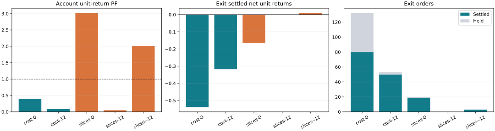
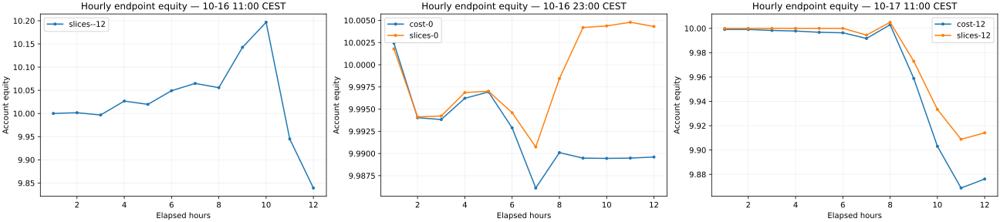

# Exit comparison results — 25 October 2026 — Europe/Vienna

5 audited 12-hour replays, each with 12 symbols, 150h fitting history, 1/5/15m lanes and minute pricing. These are funded modeled executions, not venue fills. Policies are frozen before each replay. PF is gross gains divided by gross losses after costs: 1.0 is neutral, above 1 profitable, below 1 losing. Samples without losses show ∞; empty samples show no measured PF. Independent losses remain included.

Order counts are opened / settled / held; position counts are opened / closed / held. Positions can overlap across ranges or tactics and must not be added across groups. ∞ describes a positive sample with zero losses; it is not a finite PF of 4, and the settled count still matters.

| Scenario | Account PF | Equity DD | Account orders | Account positions | Exit PF | Exit orders | Exit positions | Wall seconds | Peak MiB |
|---|---:|---:|---|---|---:|---|---|---:|---:|
| cost-0 | 0.3956 | 0.1858% | 396/278/118 | 18/7/11 | 0.0574 | 132/80/52 | 12/5/7 | 639.1 | 2749.1 |
| cost-12 | 0.0862 | 1.5785% | 1150/334/816 | 11/7/4 | 0.1957 | 53/50/3 | 10/7/3 | 510.4 | 3552.2 |
| slices-0 | 3.0130 | 0.1375% | 450/383/67 | 11/5/6 | 0.0000 | 20/19/1 | 1/0/1 | 580.9 | 3540.3 |
| slices-12 | 0.0480 | 1.1631% | 852/271/581 | 1/0/1 | — (empty) | 0/0/0 | 0/0/0 | 670.7 | 3504.5 |
| slices--12 | 2.0136 | 5.5674% | 12277/8672/3605 | 23/13/10 | ∞ (no losses) | 3/3/0 | 1/1/0 | 653.6 | 4159.9 |

Hourly results below use settled-close reporting bins; calculations still use minute prices. Cohort-boundary holdings are included by the independent position/order ledger. The coverage archive counts both directions for every config, including the ineligible opposite side of side-specific Exit IDs; those all-orientation percentages must not be presented as eligible-side percentages.

## cost-0

Independent Exit Base: 28 / 663 source-lane pairs passed. Its holdout evaluated 6852 candidate configs and retained 431; 431 Exit configs were built. These are distinct stages, not order counts.

All Signal/Exit configs built: 126613 across 118 sources and 663 source lanes; missing configured cells: 0. At run start, 7529 configs had a passing exact symbol/direction context; 10324 / 3038712 all-orientation contexts passed all gates. Signals use independent exact-config qualification, not the representative Base-pair result.

| Executed range/type | Orders | Positions | PF (neutral 1) | Gross unit gain | Gross unit loss |
|---|---|---|---:|---:|---:|
| Signals / all | 264/198/66 | 10/5/5 | 1.2320 | 0.284727 | 0.231108 |
| Signals / trailing | 208/150/58 | 9/4/5 | 0.8231 | 0.156929 | 0.190648 |
| Signals / trailing-only | 34/28/6 | 6/3/3 | 5.7011 | 0.050995 | 0.008945 |
| Signals / normal | 22/20/2 | 7/5/2 | 2.4370 | 0.076803 | 0.031516 |
| Exit / all | 132/80/52 | 12/5/7 | 0.0574 | 0.032820 | 0.571540 |
| Exit / exit:trailing-only | 69/40/29 | 7/3/4 | 0.0868 | 0.021260 | 0.244811 |
| Exit / exit:trailing | 35/17/18 | 7/2/5 | 0.0000 | 0.000000 | 0.173363 |
| Exit / exit:breakeven | 14/11/3 | 7/5/2 | 0.1786 | 0.011560 | 0.064741 |
| Exit / exit:static-sl | 5/5/0 | 2/2/0 | 0.0000 | 0.000000 | 0.033678 |
| Exit / exit:adaptive-sl | 9/7/2 | 5/3/2 | 0.0000 | 0.000000 | 0.054947 |

| Exit tactic | Orders | Positions | PF | Gross unit gain | Gross unit loss |
|---|---|---|---:|---:|---:|
| static-sl | 5/5/0 | 2/2/0 | 0.0000 | 0.000000 | 0.033678 |
| adaptive-sl | 9/7/2 | 5/3/2 | 0.0000 | 0.000000 | 0.054947 |
| trailing | 35/17/18 | 7/2/5 | 0.0000 | 0.000000 | 0.173363 |
| breakeven | 14/11/3 | 7/5/2 | 0.1786 | 0.011560 | 0.064741 |
| trailing-only | 69/40/29 | 7/3/4 | 0.0868 | 0.021260 | 0.244811 |

| Range/type | Configs | Sources | Symbols | Configs with any Last-4 at start | All-orientation contexts Last-4 | Max SL/TP | Min trail gap |
|---|---:|---:|---:|---:|---:|---:|---:|
| type: exit | 431 | 12 | 12 | 98.84% | 46.52% | 2 | 0.002 |
| strategyRange: Exit | 431 | 12 | 12 | 98.84% | 46.52% | 2 | 0.002 |
| lane: 15 | 37147 | 118 | 12 | 78.29% | 39.81% | 3 | 0.002 |
| type: normal | 27625 | 118 | 12 | 82.16% | 32.84% | 3 | — |
| strategyRange: Signals | 126182 | 118 | 12 | 82.11% | 33.41% | 3 | 0.002 |
| lane: 1 | 45527 | 118 | 12 | 80.87% | 13.61% | 2.6785714285714284 | 0.0025 |
| type: trailing | 82645 | 118 | 12 | 81.99% | 33.49% | 3 | 0.002 |
| type: trailing-only | 15912 | 118 | 12 | 82.68% | 34.03% | — | 0.0025 |
| lane: 5 | 43939 | 118 | 12 | 86.79% | 48.66% | 2.7040816326530615 | 0.00275 |

| Hour Vienna | Orders | Positions | Settled PF | Equity | Max DD so far | Exit settled |
|---|---|---|---:|---:|---:|---:|
| 10-16 23:00 CEST | 226/26/200 | 8/1/7 | 1.6716 | 10.002433 | 0.0453% | 0 |
| 10-17 00:00 CEST | 3/93/110 | 1/0/8 | 0.2870 | 9.994034 | 0.0990% | 8 |
| 10-17 01:00 CEST | 1/1/110 | 1/0/9 | 0.0000 | 9.993826 | 0.1064% | 1 |
| 10-17 02:00 CEST | 38/4/144 | 3/1/11 | 2.9407 | 9.996224 | 0.1064% | 1 |
| 10-17 03:00 CEST | 57/21/180 | 0/0/11 | 0.0014 | 9.996932 | 0.1064% | 0 |
| 10-17 04:00 CEST | 10/4/186 | 0/0/11 | 0.3401 | 9.992889 | 0.1383% | 0 |
| 10-17 05:00 CEST | 39/14/211 | 5/2/14 | 0.1801 | 9.986110 | 0.1858% | 7 |
| 10-17 06:00 CEST | 22/45/188 | 0/1/13 | 0.6342 | 9.990097 | 0.1858% | 13 |
| 10-17 07:00 CEST | 0/12/176 | 0/1/12 | ∞ | 9.989477 | 0.1858% | 0 |
| 10-17 08:00 CEST | 0/14/162 | 0/1/11 | 0.3211 | 9.989446 | 0.1858% | 9 |
| 10-17 09:00 CEST | 0/39/123 | 0/0/11 | 0.0170 | 9.989480 | 0.1858% | 36 |
| 10-17 10:00 CEST | 0/5/118 | 0/0/11 | 0.0000 | 9.989603 | 0.1858% | 5 |

## cost-12

Independent Exit Base: 27 / 663 source-lane pairs passed. Its holdout evaluated 7896 candidate configs and retained 282; 282 Exit configs were built. These are distinct stages, not order counts.

All Signal/Exit configs built: 126561 across 118 sources and 663 source lanes; missing configured cells: 0. At run start, 7292 configs had a passing exact symbol/direction context; 9858 / 3037464 all-orientation contexts passed all gates. Signals use independent exact-config qualification, not the representative Base-pair result.

| Executed range/type | Orders | Positions | PF (neutral 1) | Gross unit gain | Gross unit loss |
|---|---|---|---:|---:|---:|
| Exit / all | 53/50/3 | 10/7/3 | 0.1957 | 0.077389 | 0.395377 |
| Exit / exit:adaptive-sl | 4/4/0 | 2/2/0 | 0.0000 | 0.000000 | 0.057200 |
| Exit / exit:trailing-only | 30/29/1 | 10/9/1 | 0.7340 | 0.067855 | 0.092451 |
| Exit / exit:trailing | 17/15/2 | 7/5/2 | 0.0497 | 0.009534 | 0.191726 |
| Exit / exit:breakeven | 2/2/0 | 1/1/0 | 0.0000 | 0.000000 | 0.054000 |
| Signals / all | 1097/284/813 | 1/0/1 | 0.0399 | 0.037326 | 0.934846 |
| Signals / trailing | 812/175/637 | 1/0/1 | 0.1117 | 0.025495 | 0.228311 |
| Signals / normal | 121/49/72 | 1/0/1 | 0.0000 | 0.000000 | 0.549374 |
| Signals / trailing-only | 164/60/104 | 1/0/1 | 0.0753 | 0.011831 | 0.157160 |

| Exit tactic | Orders | Positions | PF | Gross unit gain | Gross unit loss |
|---|---|---|---:|---:|---:|
| static-sl | 0/0/0 | 0/0/0 | empty | 0 | 0 |
| adaptive-sl | 4/4/0 | 2/2/0 | 0.0000 | 0.000000 | 0.057200 |
| trailing | 17/15/2 | 7/5/2 | 0.0497 | 0.009534 | 0.191726 |
| breakeven | 2/2/0 | 1/1/0 | 0.0000 | 0.000000 | 0.054000 |
| trailing-only | 30/29/1 | 10/9/1 | 0.7340 | 0.067855 | 0.092451 |

| Range/type | Configs | Sources | Symbols | Configs with any Last-4 at start | All-orientation contexts Last-4 | Max SL/TP | Min trail gap |
|---|---:|---:|---:|---:|---:|---:|---:|
| type: exit | 282 | 10 | 12 | 100.00% | 42.32% | 3.5714285714285716 | 0.0021 |
| strategyRange: Exit | 282 | 10 | 12 | 100.00% | 42.32% | 3.5714285714285716 | 0.0021 |
| lane: 15 | 37042 | 118 | 12 | 79.09% | 40.26% | 3.5714285714285716 | 0.002 |
| type: normal | 27630 | 118 | 12 | 82.48% | 33.12% | 3 | — |
| strategyRange: Signals | 126279 | 118 | 12 | 82.49% | 33.75% | 3 | 0.002 |
| lane: 1 | 45530 | 118 | 12 | 81.17% | 13.64% | 2.6785714285714284 | 0.0025 |
| type: trailing | 82737 | 118 | 12 | 82.40% | 33.83% | 3 | 0.002 |
| type: trailing-only | 15912 | 118 | 12 | 82.98% | 34.39% | — | 0.0025 |
| lane: 5 | 43989 | 118 | 12 | 86.84% | 49.12% | 2.7040816326530615 | 0.00275 |

| Hour Vienna | Orders | Positions | Settled PF | Equity | Max DD so far | Exit settled |
|---|---|---|---:|---:|---:|---:|
| 10-17 11:00 CEST | 26/0/26 | 2/0/2 | — (flat/empty) | 9.999082 | 0.0092% | 0 |
| 10-17 12:00 CEST | 1/12/15 | 1/1/2 | — (flat/empty) | 9.999084 | 0.0130% | 12 |
| 10-17 13:00 CEST | 2/0/17 | 1/0/3 | — (flat/empty) | 9.998274 | 0.0177% | 0 |
| 10-17 14:00 CEST | 11/1/27 | 2/0/5 | 0.0000 | 9.997798 | 0.0235% | 1 |
| 10-17 15:00 CEST | 6/12/21 | 2/0/7 | 0.0364 | 9.996772 | 0.0332% | 12 |
| 10-17 16:00 CEST | 0/3/18 | 0/0/7 | 0.4074 | 9.996344 | 0.0370% | 3 |
| 10-17 17:00 CEST | 656/0/674 | 2/0/9 | — (flat/empty) | 9.991704 | 0.1393% | 0 |
| 10-17 18:00 CEST | 47/71/650 | 1/1/9 | 0.0105 | 10.002955 | 0.2645% | 4 |
| 10-17 19:00 CEST | 390/168/872 | 0/2/7 | 0.3665 | 9.958836 | 0.6483% | 3 |
| 10-17 20:00 CEST | 11/40/843 | 0/2/5 | 0.0784 | 9.903067 | 1.3531% | 12 |
| 10-17 21:00 CEST | 0/27/816 | 0/1/4 | 0.0002 | 9.868801 | 1.5416% | 3 |
| 10-17 22:00 CEST | 0/0/816 | 0/0/4 | — (flat/empty) | 9.876183 | 1.5785% | 0 |

## slices-0

Independent Exit Base: 28 / 663 source-lane pairs passed. Its holdout evaluated 6852 candidate configs and retained 32; 32 Exit configs were built. These are distinct stages, not order counts.

All Signal/Exit configs built: 126214 across 118 sources and 663 source lanes; missing configured cells: 0. At run start, 7260 configs had a passing exact symbol/direction context; 9814 / 3029136 all-orientation contexts passed all gates. Signals use independent exact-config qualification, not the representative Base-pair result.

| Executed range/type | Orders | Positions | PF (neutral 1) | Gross unit gain | Gross unit loss |
|---|---|---|---:|---:|---:|
| Signals / all | 430/364/66 | 11/6/5 | 4.8548 | 1.316576 | 0.271190 |
| Signals / trailing | 320/262/58 | 9/4/5 | 4.4247 | 0.864724 | 0.195429 |
| Signals / trailing-only | 60/54/6 | 7/4/3 | 6.8465 | 0.139975 | 0.020445 |
| Signals / normal | 50/48/2 | 8/6/2 | 5.6381 | 0.311877 | 0.055316 |
| Exit / all | 20/19/1 | 1/0/1 | 0.0000 | 0.000000 | 0.165780 |
| Exit / exit:static-sl | 4/4/0 | 1/1/0 | 0.0000 | 0.000000 | 0.030491 |
| Exit / exit:breakeven | 3/3/0 | 1/1/0 | 0.0000 | 0.000000 | 0.022868 |
| Exit / exit:adaptive-sl | 2/2/0 | 1/1/0 | 0.0000 | 0.000000 | 0.019722 |
| Exit / exit:trailing | 4/4/0 | 1/1/0 | 0.0000 | 0.000000 | 0.037966 |
| Exit / exit:trailing-only | 7/6/1 | 1/0/1 | 0.0000 | 0.000000 | 0.054733 |

| Exit tactic | Orders | Positions | PF | Gross unit gain | Gross unit loss |
|---|---|---|---:|---:|---:|
| static-sl | 4/4/0 | 1/1/0 | 0.0000 | 0.000000 | 0.030491 |
| adaptive-sl | 2/2/0 | 1/1/0 | 0.0000 | 0.000000 | 0.019722 |
| trailing | 4/4/0 | 1/1/0 | 0.0000 | 0.000000 | 0.037966 |
| breakeven | 3/3/0 | 1/1/0 | 0.0000 | 0.000000 | 0.022868 |
| trailing-only | 7/6/1 | 1/0/1 | 0.0000 | 0.000000 | 0.054733 |

| Range/type | Configs | Sources | Symbols | Configs with any Last-4 at start | All-orientation contexts Last-4 | Max SL/TP | Min trail gap |
|---|---:|---:|---:|---:|---:|---:|---:|
| type: exit | 32 | 4 | 12 | 100.00% | 44.40% | 2 | 0.00585 |
| strategyRange: Exit | 32 | 4 | 12 | 100.00% | 44.40% | 2 | 0.00585 |
| lane: 15 | 36748 | 118 | 12 | 78.07% | 39.74% | 3 | 0.002 |
| type: normal | 27625 | 118 | 12 | 82.16% | 32.84% | 3 | — |
| strategyRange: Signals | 126182 | 118 | 12 | 82.11% | 33.41% | 3 | 0.002 |
| lane: 1 | 45527 | 118 | 12 | 80.87% | 13.61% | 2.6785714285714284 | 0.0025 |
| type: trailing | 82645 | 118 | 12 | 81.99% | 33.49% | 3 | 0.002 |
| type: trailing-only | 15912 | 118 | 12 | 82.68% | 34.03% | — | 0.0025 |
| lane: 5 | 43939 | 118 | 12 | 86.79% | 48.66% | 2.7040816326530615 | 0.00275 |

| Hour Vienna | Orders | Positions | Settled PF | Equity | Max DD so far | Exit settled |
|---|---|---|---:|---:|---:|---:|
| 10-16 23:00 CEST | 216/26/190 | 7/1/6 | 1.6716 | 10.001795 | 0.0396% | 0 |
| 10-17 00:00 CEST | 0/85/105 | 0/0/6 | 0.2113 | 9.994125 | 0.0911% | 0 |
| 10-17 01:00 CEST | 0/0/105 | 0/0/6 | — (flat/empty) | 9.994219 | 0.0980% | 0 |
| 10-17 02:00 CEST | 0/3/102 | 0/0/6 | 0.0000 | 9.996869 | 0.0980% | 0 |
| 10-17 03:00 CEST | 20/21/101 | 0/0/6 | 0.0014 | 9.997018 | 0.0980% | 0 |
| 10-17 04:00 CEST | 0/4/97 | 0/0/6 | 0.3401 | 9.994590 | 0.1002% | 0 |
| 10-17 05:00 CEST | 42/7/132 | 4/0/10 | 0.0000 | 9.990737 | 0.1234% | 0 |
| 10-17 06:00 CEST | 113/125/120 | 0/2/8 | 4.8820 | 9.998439 | 0.1375% | 7 |
| 10-17 07:00 CEST | 59/69/110 | 0/1/7 | 28.4980 | 10.004195 | 0.1375% | 0 |
| 10-17 08:00 CEST | 0/27/83 | 0/0/7 | 31.7729 | 10.004376 | 0.1375% | 0 |
| 10-17 09:00 CEST | 0/16/67 | 0/1/6 | 0.2140 | 10.004790 | 0.1375% | 12 |
| 10-17 10:00 CEST | 0/0/67 | 0/0/6 | — (flat/empty) | 10.004313 | 0.1375% | 0 |

## slices-12

Independent Exit Base: 27 / 663 source-lane pairs passed. Its holdout evaluated 7896 candidate configs and retained 0; 0 Exit configs were built. These are distinct stages, not order counts.

All Signal/Exit configs built: 126279 across 118 sources and 663 source lanes; missing configured cells: 0. At run start, 7096 configs had a passing exact symbol/direction context; 9637 / 3030696 all-orientation contexts passed all gates. Signals use independent exact-config qualification, not the representative Base-pair result.

| Executed range/type | Orders | Positions | PF (neutral 1) | Gross unit gain | Gross unit loss |
|---|---|---|---:|---:|---:|
| Signals / all | 852/271/581 | 1/0/1 | 0.0480 | 0.037326 | 0.777424 |
| Signals / trailing | 632/174/458 | 1/0/1 | 0.1159 | 0.025495 | 0.220064 |
| Signals / normal | 93/39/54 | 1/0/1 | 0.0000 | 0.000000 | 0.423199 |
| Signals / trailing-only | 127/58/69 | 1/0/1 | 0.0882 | 0.011831 | 0.134160 |

| Exit tactic | Orders | Positions | PF | Gross unit gain | Gross unit loss |
|---|---|---|---:|---:|---:|
| static-sl | 0/0/0 | 0/0/0 | empty | 0 | 0 |
| adaptive-sl | 0/0/0 | 0/0/0 | empty | 0 | 0 |
| trailing | 0/0/0 | 0/0/0 | empty | 0 | 0 |
| breakeven | 0/0/0 | 0/0/0 | empty | 0 | 0 |
| trailing-only | 0/0/0 | 0/0/0 | empty | 0 | 0 |

| Range/type | Configs | Sources | Symbols | Configs with any Last-4 at start | All-orientation contexts Last-4 | Max SL/TP | Min trail gap |
|---|---:|---:|---:|---:|---:|---:|---:|
| type: normal | 27630 | 118 | 12 | 82.48% | 33.12% | 3 | — |
| strategyRange: Signals | 126279 | 118 | 12 | 82.49% | 33.75% | 3 | 0.002 |
| lane: 1 | 45530 | 118 | 12 | 81.17% | 13.64% | 2.6785714285714284 | 0.0025 |
| type: trailing | 82737 | 118 | 12 | 82.40% | 33.83% | 3 | 0.002 |
| type: trailing-only | 15912 | 118 | 12 | 82.98% | 34.39% | — | 0.0025 |
| lane: 5 | 43989 | 118 | 12 | 86.84% | 49.12% | 2.7040816326530615 | 0.00275 |
| lane: 15 | 36760 | 118 | 12 | 78.93% | 40.25% | 3 | 0.002 |

| Hour Vienna | Orders | Positions | Settled PF | Equity | Max DD so far | Exit settled |
|---|---|---|---:|---:|---:|---:|
| 10-17 11:00 CEST | 0/0/0 | 0/0/0 | — (flat/empty) | 10.000000 | 0.0000% | 0 |
| 10-17 12:00 CEST | 0/0/0 | 0/0/0 | — (flat/empty) | 10.000000 | 0.0000% | 0 |
| 10-17 13:00 CEST | 0/0/0 | 0/0/0 | — (flat/empty) | 10.000000 | 0.0000% | 0 |
| 10-17 14:00 CEST | 0/0/0 | 0/0/0 | — (flat/empty) | 10.000000 | 0.0000% | 0 |
| 10-17 15:00 CEST | 0/0/0 | 0/0/0 | — (flat/empty) | 10.000000 | 0.0000% | 0 |
| 10-17 16:00 CEST | 0/0/0 | 0/0/0 | — (flat/empty) | 10.000000 | 0.0000% | 0 |
| 10-17 17:00 CEST | 650/0/650 | 1/0/1 | — (flat/empty) | 9.994461 | 0.1116% | 0 |
| 10-17 18:00 CEST | 46/67/629 | 0/0/1 | 0.0000 | 10.005009 | 0.2328% | 0 |
| 10-17 19:00 CEST | 156/165/620 | 0/0/1 | 0.1814 | 9.972970 | 0.5001% | 0 |
| 10-17 20:00 CEST | 0/20/600 | 0/0/1 | 0.0000 | 9.933356 | 1.0028% | 0 |
| 10-17 21:00 CEST | 0/19/581 | 0/0/1 | 0.0000 | 9.908838 | 1.1368% | 0 |
| 10-17 22:00 CEST | 0/0/581 | 0/0/1 | — (flat/empty) | 9.914125 | 1.1631% | 0 |

## slices--12

Independent Exit Base: 30 / 663 source-lane pairs passed. Its holdout evaluated 5970 candidate configs and retained 15; 15 Exit configs were built. These are distinct stages, not order counts.

All Signal/Exit configs built: 126096 across 118 sources and 663 source lanes; missing configured cells: 0. At run start, 4160 configs had a passing exact symbol/direction context; 5044 / 3026304 all-orientation contexts passed all gates. Signals use independent exact-config qualification, not the representative Base-pair result.

| Executed range/type | Orders | Positions | PF (neutral 1) | Gross unit gain | Gross unit loss |
|---|---|---|---:|---:|---:|
| Signals / all | 12274/8669/3605 | 23/13/10 | 2.0130 | 33.133748 | 16.460035 |
| Signals / normal | 1357/1059/298 | 27/17/10 | 0.8731 | 3.544842 | 4.060050 |
| Signals / trailing | 9270/6531/2739 | 26/16/10 | 2.2694 | 25.011643 | 11.021273 |
| Signals / trailing-only | 1647/1079/568 | 25/16/9 | 3.3200 | 4.577263 | 1.378712 |
| Exit / all | 3/3/0 | 1/1/0 | ∞ (no losses) | 0.009871 | 0.000000 |
| Exit / exit:adaptive-sl | 1/1/0 | 1/1/0 | ∞ (no losses) | 0.003290 | 0.000000 |
| Exit / exit:trailing | 2/2/0 | 1/1/0 | ∞ (no losses) | 0.006581 | 0.000000 |

| Exit tactic | Orders | Positions | PF | Gross unit gain | Gross unit loss |
|---|---|---|---:|---:|---:|
| static-sl | 0/0/0 | 0/0/0 | empty | 0 | 0 |
| adaptive-sl | 1/1/0 | 1/1/0 | ∞ (no losses) | 0.003290 | 0.000000 |
| trailing | 2/2/0 | 1/1/0 | ∞ (no losses) | 0.006581 | 0.000000 |
| breakeven | 0/0/0 | 0/0/0 | empty | 0 | 0 |
| trailing-only | 0/0/0 | 0/0/0 | empty | 0 | 0 |

| Range/type | Configs | Sources | Symbols | Configs with any Last-4 at start | All-orientation contexts Last-4 | Max SL/TP | Min trail gap |
|---|---:|---:|---:|---:|---:|---:|---:|
| type: exit | 15 | 3 | 12 | 100.00% | 37.78% | 0.4261363636363636 | 0.024275 |
| strategyRange: Exit | 15 | 3 | 12 | 100.00% | 37.78% | 0.4261363636363636 | 0.024275 |
| lane: 15 | 36722 | 118 | 12 | 75.07% | 37.13% | 3 | 0.002 |
| type: normal | 27625 | 118 | 12 | 78.03% | 30.75% | 3 | — |
| strategyRange: Signals | 126081 | 118 | 12 | 78.03% | 31.06% | 3 | 0.002 |
| lane: 1 | 45526 | 118 | 12 | 73.15% | 12.43% | 2.6785714285714284 | 0.0025 |
| type: trailing | 82544 | 118 | 12 | 77.92% | 31.05% | 3 | 0.002 |
| type: trailing-only | 15912 | 118 | 12 | 78.58% | 31.66% | — | 0.0025 |
| lane: 5 | 43848 | 118 | 12 | 85.57% | 45.33% | 2.7040816326530615 | 0.00275 |

| Hour Vienna | Orders | Positions | Settled PF | Equity | Max DD so far | Exit settled |
|---|---|---|---:|---:|---:|---:|
| 10-16 11:00 CEST | 0/0/0 | 0/0/0 | — (flat/empty) | 10.000000 | 0.0000% | 0 |
| 10-16 12:00 CEST | 69/37/32 | 2/0/2 | 29.1667 | 10.001622 | 0.0131% | 0 |
| 10-16 13:00 CEST | 627/135/524 | 3/0/5 | 0.1318 | 9.996770 | 0.0995% | 0 |
| 10-16 14:00 CEST | 604/489/639 | 1/1/5 | 7.6658 | 10.026705 | 0.0995% | 0 |
| 10-16 15:00 CEST | 474/424/689 | 5/1/9 | 8.7709 | 10.019680 | 0.2392% | 0 |
| 10-16 16:00 CEST | 199/342/546 | 3/1/11 | 3.1439 | 10.049145 | 0.3896% | 0 |
| 10-16 17:00 CEST | 1494/901/1139 | 6/3/14 | 2.0368 | 10.064821 | 0.3896% | 0 |
| 10-16 18:00 CEST | 1055/399/1795 | 0/2/12 | 0.9040 | 10.055664 | 1.1805% | 0 |
| 10-16 19:00 CEST | 3046/2320/2521 | 2/4/10 | 3.8378 | 10.142653 | 2.3327% | 0 |
| 10-16 20:00 CEST | 2656/1479/3698 | 1/1/10 | 4.7822 | 10.196795 | 2.5580% | 0 |
| 10-16 21:00 CEST | 2053/1827/3924 | 0/0/10 | 0.3588 | 9.944971 | 4.8760% | 0 |
| 10-16 22:00 CEST | 0/319/3605 | 0/0/10 | 0.0219 | 9.839222 | 5.5674% | 3 |
