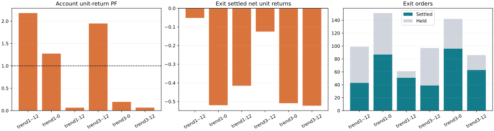
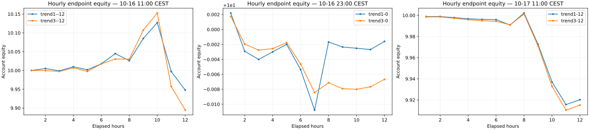

# Exit comparison results — 25 October 2026 — Europe/Vienna

6 audited 12-hour replays, each with 12 symbols, 150h fitting history, 1/5/15m lanes and minute pricing. These are funded modeled executions, not venue fills. Policies are frozen before each replay. PF is gross gains divided by gross losses after costs: 1.0 is neutral, above 1 profitable, below 1 losing. Samples without losses show ∞; empty samples show no measured PF. Independent losses remain included.

Order counts are opened / settled / held; position counts are opened / closed / held. Positions can overlap across ranges or tactics and must not be added across groups. ∞ describes a positive sample with zero losses; it is not a finite PF of 4, and the settled count still matters.

| Scenario | Account PF | Equity DD | Account orders | Account positions | Exit PF | Exit orders | Exit positions | Wall seconds | Peak MiB |
|---|---:|---:|---|---|---:|---|---|---:|---:|
| trend1--12 | 2.1784 | 3.2041% | 7469/5629/1840 | 23/12/11 | 0.7943 | 99/43/56 | 14/4/10 | 442.6 | 2951.1 |
| trend1-0 | 1.2740 | 0.1545% | 435/336/99 | 14/6/8 | 0.0500 | 151/87/64 | 9/3/6 | 557.9 | 3011.6 |
| trend1-12 | 0.0656 | 1.0580% | 831/312/519 | 12/6/6 | 0.0809 | 61/51/10 | 11/6/5 | 312.4 | 2998.7 |
| trend3--12 | 1.9467 | 4.1915% | 9515/6895/2620 | 22/11/11 | 0.5031 | 97/39/58 | 13/4/9 | 422.4 | 2891.3 |
| trend3-0 | 0.1954 | 0.1212% | 307/247/60 | 14/4/10 | 0.0458 | 142/96/46 | 10/2/8 | 317.1 | 2865.1 |
| trend3-12 | 0.0673 | 1.0897% | 868/314/554 | 14/5/9 | 0.0975 | 86/63/23 | 13/5/8 | 565.2 | 3453.1 |

Hourly results below use settled-close reporting bins; calculations still use minute prices. Cohort-boundary holdings are included by the independent position/order ledger. The coverage archive counts both directions for every config, including the ineligible opposite side of side-specific Exit IDs; those all-orientation percentages must not be presented as eligible-side percentages.

## trend1--12

Independent Exit Base: 30 / 663 source-lane pairs passed. Its holdout evaluated 5970 candidate configs and retained 253; 253 Exit configs were built. These are distinct stages, not order counts.

All Signal/Exit configs built: 126295 across 118 sources and 663 source lanes; missing configured cells: 0. At run start, 3297 configs had a passing exact symbol/direction context; 4205 / 3031080 all-orientation contexts passed all gates. Signals use independent exact-config qualification, not the representative Base-pair result.

| Executed range/type | Orders | Positions | PF (neutral 1) | Gross unit gain | Gross unit loss |
|---|---|---|---:|---:|---:|
| Signals / all | 7370/5586/1784 | 25/16/9 | 2.2122 | 22.766749 | 10.291233 |
| Signals / trailing | 5491/4172/1319 | 28/19/9 | 2.5981 | 17.155869 | 6.603232 |
| Signals / normal | 892/698/194 | 26/19/7 | 0.9722 | 2.579562 | 2.653219 |
| Signals / trailing-only | 987/716/271 | 31/23/8 | 2.9294 | 3.031318 | 1.034782 |
| Exit / all | 99/43/56 | 14/4/10 | 0.7943 | 0.200163 | 0.252000 |
| Exit / exit:trailing-only | 33/19/14 | 10/6/4 | ∞ (no losses) | 0.097383 | 0.000000 |
| Exit / exit:trailing | 16/13/3 | 5/3/2 | ∞ (no losses) | 0.087431 | 0.000000 |
| Exit / exit:adaptive-sl | 16/3/13 | 5/1/4 | ∞ (no losses) | 0.015349 | 0.000000 |
| Exit / exit:static-sl | 17/4/13 | 4/1/3 | 0.0000 | 0.000000 | 0.126000 |
| Exit / exit:breakeven | 17/4/13 | 4/1/3 | 0.0000 | 0.000000 | 0.126000 |

| Exit tactic | Orders | Positions | PF | Gross unit gain | Gross unit loss |
|---|---|---|---:|---:|---:|
| static-sl | 17/4/13 | 4/1/3 | 0.0000 | 0.000000 | 0.126000 |
| adaptive-sl | 16/3/13 | 5/1/4 | ∞ (no losses) | 0.015349 | 0.000000 |
| trailing | 16/13/3 | 5/3/2 | ∞ (no losses) | 0.087431 | 0.000000 |
| breakeven | 17/4/13 | 4/1/3 | 0.0000 | 0.000000 | 0.126000 |
| trailing-only | 33/19/14 | 10/6/4 | ∞ (no losses) | 0.097383 | 0.000000 |

| Range/type | Configs | Sources | Symbols | Configs with any Last-4 at start | All-orientation contexts Last-4 | Max SL/TP | Min trail gap |
|---|---:|---:|---:|---:|---:|---:|---:|
| type: exit | 253 | 9 | 12 | 100.00% | 39.77% | 1.0204081632653061 | 0.0112 |
| strategyRange: Exit | 253 | 9 | 12 | 100.00% | 39.77% | 1.0204081632653061 | 0.0112 |
| lane: 15 | 36947 | 118 | 12 | 60.36% | 27.49% | 3 | 0.002 |
| type: normal | 27625 | 118 | 12 | 60.97% | 22.08% | 3 | — |
| strategyRange: Signals | 126042 | 118 | 12 | 61.13% | 22.38% | 3 | 0.002 |
| lane: 1 | 45526 | 118 | 12 | 53.17% | 7.25% | 2.6785714285714284 | 0.0025 |
| type: trailing | 82505 | 118 | 12 | 61.10% | 22.43% | 3 | 0.002 |
| type: trailing-only | 15912 | 118 | 12 | 61.54% | 22.65% | — | 0.0025 |
| lane: 5 | 43822 | 118 | 12 | 70.26% | 33.90% | 2.7040816326530615 | 0.00275 |

| Hour Vienna | Orders | Positions | Settled PF | Equity | Max DD so far | Exit settled |
|---|---|---|---:|---:|---:|---:|
| 10-16 11:00 CEST | 3/0/3 | 2/0/2 | — (flat/empty) | 9.999956 | 0.0010% | 0 |
| 10-16 12:00 CEST | 146/113/36 | 5/0/7 | 12.5031 | 10.005067 | 0.0437% | 0 |
| 10-16 13:00 CEST | 95/57/74 | 1/0/8 | 0.0000 | 9.999082 | 0.1063% | 0 |
| 10-16 14:00 CEST | 356/86/344 | 1/1/8 | 2.6529 | 10.009743 | 0.1695% | 0 |
| 10-16 15:00 CEST | 418/264/498 | 3/1/10 | 6.5364 | 10.001794 | 0.2308% | 0 |
| 10-16 16:00 CEST | 61/182/377 | 1/1/10 | 1.0638 | 10.017811 | 0.4004% | 0 |
| 10-16 17:00 CEST | 1272/580/1069 | 5/2/13 | 8.9399 | 10.044742 | 0.4229% | 0 |
| 10-16 18:00 CEST | 905/341/1633 | 0/1/12 | 0.7729 | 10.025866 | 1.1114% | 7 |
| 10-16 19:00 CEST | 2414/2137/1910 | 2/4/10 | 2.9780 | 10.085031 | 2.1627% | 34 |
| 10-16 20:00 CEST | 1418/980/2348 | 2/2/10 | 2.2191 | 10.127074 | 2.4751% | 0 |
| 10-16 21:00 CEST | 381/821/1908 | 1/0/11 | 0.2460 | 9.997134 | 2.8516% | 0 |
| 10-16 22:00 CEST | 0/68/1840 | 0/0/11 | 0.0074 | 9.947795 | 3.2041% | 2 |

## trend1-0

Independent Exit Base: 28 / 663 source-lane pairs passed. Its holdout evaluated 6720 candidate configs and retained 416; 416 Exit configs were built. These are distinct stages, not order counts.

All Signal/Exit configs built: 126525 across 118 sources and 663 source lanes; missing configured cells: 0. At run start, 5592 configs had a passing exact symbol/direction context; 7670 / 3036600 all-orientation contexts passed all gates. Signals use independent exact-config qualification, not the representative Base-pair result.

| Executed range/type | Orders | Positions | PF (neutral 1) | Gross unit gain | Gross unit loss |
|---|---|---|---:|---:|---:|
| Signals / all | 284/249/35 | 7/4/3 | 6.4951 | 0.833214 | 0.128284 |
| Signals / trailing | 202/176/26 | 6/4/2 | 5.8453 | 0.543459 | 0.092973 |
| Signals / normal | 30/27/3 | 6/4/2 | 4.8908 | 0.160927 | 0.032904 |
| Signals / trailing-only | 52/46/6 | 4/2/2 | 53.5291 | 0.128828 | 0.002407 |
| Exit / all | 151/87/64 | 9/3/6 | 0.0500 | 0.027360 | 0.547202 |
| Exit / exit:trailing-only | 77/47/30 | 7/4/3 | 0.1290 | 0.027360 | 0.212039 |
| Exit / exit:adaptive-sl | 10/8/2 | 6/4/2 | 0.0000 | 0.000000 | 0.055762 |
| Exit / exit:trailing | 47/20/27 | 8/2/6 | 0.0000 | 0.000000 | 0.212244 |
| Exit / exit:breakeven | 9/4/5 | 5/1/4 | 0.0000 | 0.000000 | 0.021619 |
| Exit / exit:static-sl | 8/8/0 | 2/2/0 | 0.0000 | 0.000000 | 0.045539 |

| Exit tactic | Orders | Positions | PF | Gross unit gain | Gross unit loss |
|---|---|---|---:|---:|---:|
| static-sl | 8/8/0 | 2/2/0 | 0.0000 | 0.000000 | 0.045539 |
| adaptive-sl | 10/8/2 | 6/4/2 | 0.0000 | 0.000000 | 0.055762 |
| trailing | 47/20/27 | 8/2/6 | 0.0000 | 0.000000 | 0.212244 |
| breakeven | 9/4/5 | 5/1/4 | 0.0000 | 0.000000 | 0.021619 |
| trailing-only | 77/47/30 | 7/4/3 | 0.1290 | 0.027360 | 0.212039 |

| Range/type | Configs | Sources | Symbols | Configs with any Last-4 at start | All-orientation contexts Last-4 | Max SL/TP | Min trail gap |
|---|---:|---:|---:|---:|---:|---:|---:|
| type: exit | 416 | 13 | 12 | 98.80% | 46.55% | 2 | 0.0035 |
| strategyRange: Exit | 416 | 13 | 12 | 98.80% | 46.55% | 2 | 0.0035 |
| lane: 15 | 37122 | 118 | 12 | 64.24% | 29.83% | 3 | 0.002 |
| type: normal | 27625 | 118 | 12 | 65.84% | 24.16% | 3 | — |
| strategyRange: Signals | 126109 | 118 | 12 | 65.92% | 24.63% | 3 | 0.002 |
| lane: 1 | 45530 | 118 | 12 | 62.14% | 8.55% | 2.6785714285714284 | 0.0025 |
| type: trailing | 82572 | 118 | 12 | 65.78% | 24.73% | 3 | 0.002 |
| type: trailing-only | 15912 | 118 | 12 | 66.79% | 24.95% | — | 0.0025 |
| lane: 5 | 43873 | 118 | 12 | 71.57% | 37.13% | 2.7040816326530615 | 0.00275 |

| Hour Vienna | Orders | Positions | Settled PF | Equity | Max DD so far | Exit settled |
|---|---|---|---:|---:|---:|---:|
| 10-16 23:00 CEST | 151/32/119 | 6/0/6 | 2.3531 | 10.002195 | 0.0374% | 0 |
| 10-17 00:00 CEST | 4/55/68 | 1/0/7 | 1.0126 | 9.997078 | 0.0635% | 14 |
| 10-17 01:00 CEST | 0/6/62 | 0/0/7 | 0.0000 | 9.995990 | 0.0710% | 5 |
| 10-17 02:00 CEST | 43/2/103 | 2/0/9 | 0.0000 | 9.997006 | 0.0710% | 0 |
| 10-17 03:00 CEST | 41/16/128 | 0/0/9 | 0.0004 | 9.998003 | 0.0710% | 0 |
| 10-17 04:00 CEST | 33/0/161 | 2/0/11 | — (flat/empty) | 9.994628 | 0.1003% | 0 |
| 10-17 05:00 CEST | 35/7/189 | 3/3/11 | 0.2468 | 9.989217 | 0.1521% | 5 |
| 10-17 06:00 CEST | 128/123/194 | 0/1/10 | 9.4249 | 9.998317 | 0.1545% | 6 |
| 10-17 07:00 CEST | 0/37/157 | 0/1/9 | 10.8501 | 9.997652 | 0.1545% | 1 |
| 10-17 08:00 CEST | 0/7/150 | 0/0/9 | 0.0000 | 9.997483 | 0.1545% | 7 |
| 10-17 09:00 CEST | 0/28/122 | 0/0/9 | 0.0108 | 9.997314 | 0.1545% | 26 |
| 10-17 10:00 CEST | 0/23/99 | 0/1/8 | 0.0000 | 9.998402 | 0.1545% | 23 |

## trend1-12

Independent Exit Base: 27 / 663 source-lane pairs passed. Its holdout evaluated 7896 candidate configs and retained 289; 289 Exit configs were built. These are distinct stages, not order counts.

All Signal/Exit configs built: 126448 across 118 sources and 663 source lanes; missing configured cells: 0. At run start, 5408 configs had a passing exact symbol/direction context; 7218 / 3034752 all-orientation contexts passed all gates. Signals use independent exact-config qualification, not the representative Base-pair result.

| Executed range/type | Orders | Positions | PF (neutral 1) | Gross unit gain | Gross unit loss |
|---|---|---|---:|---:|---:|
| Exit / all | 61/51/10 | 11/6/5 | 0.0809 | 0.036575 | 0.451826 |
| Exit / exit:adaptive-sl | 7/6/1 | 3/2/1 | 0.0000 | 0.000000 | 0.098000 |
| Exit / exit:breakeven | 6/4/2 | 2/1/1 | — (flat) | 0.000000 | 0.000000 |
| Exit / exit:trailing-only | 22/22/0 | 7/7/0 | 0.2933 | 0.027041 | 0.092200 |
| Exit / exit:trailing | 25/18/7 | 10/5/5 | 0.0385 | 0.009534 | 0.247626 |
| Exit / exit:static-sl | 1/1/0 | 1/1/0 | 0.0000 | 0.000000 | 0.014000 |
| Signals / all | 770/261/509 | 1/0/1 | 0.0558 | 0.039462 | 0.707241 |
| Signals / trailing | 573/177/396 | 1/0/1 | 0.1340 | 0.028406 | 0.212029 |
| Signals / normal | 82/28/54 | 1/0/1 | 0.0000 | 0.000000 | 0.346590 |
| Signals / trailing-only | 115/56/59 | 1/0/1 | 0.0744 | 0.011057 | 0.148622 |

| Exit tactic | Orders | Positions | PF | Gross unit gain | Gross unit loss |
|---|---|---|---:|---:|---:|
| static-sl | 1/1/0 | 1/1/0 | 0.0000 | 0.000000 | 0.014000 |
| adaptive-sl | 7/6/1 | 3/2/1 | 0.0000 | 0.000000 | 0.098000 |
| trailing | 25/18/7 | 10/5/5 | 0.0385 | 0.009534 | 0.247626 |
| breakeven | 6/4/2 | 2/1/1 | — (flat) | 0.000000 | 0.000000 |
| trailing-only | 22/22/0 | 7/7/0 | 0.2933 | 0.027041 | 0.092200 |

| Range/type | Configs | Sources | Symbols | Configs with any Last-4 at start | All-orientation contexts Last-4 | Max SL/TP | Min trail gap |
|---|---:|---:|---:|---:|---:|---:|---:|
| type: exit | 289 | 9 | 12 | 100.00% | 42.52% | 3.5714285714285716 | 0.0021 |
| strategyRange: Exit | 289 | 9 | 12 | 100.00% | 42.52% | 3.5714285714285716 | 0.0021 |
| lane: 15 | 37006 | 118 | 12 | 64.82% | 30.18% | 3.5714285714285716 | 0.002 |
| type: normal | 27625 | 118 | 12 | 66.09% | 24.40% | 3 | — |
| strategyRange: Signals | 126159 | 118 | 12 | 66.25% | 24.94% | 3 | 0.002 |
| lane: 1 | 45526 | 118 | 12 | 62.44% | 8.60% | 2.6785714285714284 | 0.0025 |
| type: trailing | 82622 | 118 | 12 | 66.15% | 25.05% | 3 | 0.002 |
| type: trailing-only | 15912 | 118 | 12 | 67.03% | 25.32% | — | 0.0025 |
| lane: 5 | 43916 | 118 | 12 | 71.62% | 37.58% | 2.7040816326530615 | 0.00275 |

| Hour Vienna | Orders | Positions | Settled PF | Equity | Max DD so far | Exit settled |
|---|---|---|---:|---:|---:|---:|
| 10-17 11:00 CEST | 34/0/34 | 2/0/2 | — (flat/empty) | 9.998824 | 0.0119% | 0 |
| 10-17 12:00 CEST | 0/16/18 | 0/1/1 | — (flat/empty) | 9.998871 | 0.0164% | 16 |
| 10-17 13:00 CEST | 0/0/18 | 0/0/1 | — (flat/empty) | 9.997834 | 0.0226% | 0 |
| 10-17 14:00 CEST | 11/8/21 | 3/0/4 | 0.0000 | 9.996750 | 0.0330% | 8 |
| 10-17 15:00 CEST | 1/9/13 | 1/0/5 | 0.0526 | 9.996154 | 0.0388% | 9 |
| 10-17 16:00 CEST | 0/1/12 | 0/1/4 | ∞ | 9.995940 | 0.0410% | 1 |
| 10-17 17:00 CEST | 652/0/664 | 3/0/7 | — (flat/empty) | 9.990889 | 0.1517% | 0 |
| 10-17 18:00 CEST | 34/55/643 | 0/2/5 | 0.0110 | 10.002180 | 0.2695% | 5 |
| 10-17 19:00 CEST | 91/178/556 | 0/0/5 | 0.1800 | 9.972645 | 0.4712% | 0 |
| 10-17 20:00 CEST | 3/28/531 | 1/1/5 | 0.1123 | 9.937089 | 0.9163% | 11 |
| 10-17 21:00 CEST | 5/17/519 | 2/1/6 | 0.0003 | 9.915697 | 1.0350% | 1 |
| 10-17 22:00 CEST | 0/0/519 | 0/0/6 | — (flat/empty) | 9.920350 | 1.0580% | 0 |

## trend3--12

Independent Exit Base: 30 / 663 source-lane pairs passed. Its holdout evaluated 5964 candidate configs and retained 255; 255 Exit configs were built. These are distinct stages, not order counts.

All Signal/Exit configs built: 126274 across 118 sources and 663 source lanes; missing configured cells: 0. At run start, 2740 configs had a passing exact symbol/direction context; 3293 / 3030576 all-orientation contexts passed all gates. Signals use independent exact-config qualification, not the representative Base-pair result.

| Executed range/type | Orders | Positions | PF (neutral 1) | Gross unit gain | Gross unit loss |
|---|---|---|---:|---:|---:|
| Signals / all | 9418/6856/2562 | 24/14/10 | 1.9751 | 25.357911 | 12.839089 |
| Signals / normal | 1065/873/192 | 26/16/10 | 0.7241 | 2.438659 | 3.367896 |
| Signals / trailing | 7077/5148/1929 | 26/16/10 | 2.3077 | 19.185139 | 8.313510 |
| Signals / trailing-only | 1276/835/441 | 27/19/8 | 3.2255 | 3.734113 | 1.157683 |
| Exit / all | 97/39/58 | 13/4/9 | 0.5031 | 0.126769 | 0.252000 |
| Exit / exit:trailing-only | 35/19/16 | 10/5/5 | ∞ (no losses) | 0.077047 | 0.000000 |
| Exit / exit:adaptive-sl | 17/4/13 | 5/1/4 | ∞ (no losses) | 0.024847 | 0.000000 |
| Exit / exit:trailing | 11/8/3 | 2/0/2 | ∞ (no losses) | 0.024874 | 0.000000 |
| Exit / exit:static-sl | 16/4/12 | 3/1/2 | 0.0000 | 0.000000 | 0.126000 |
| Exit / exit:breakeven | 18/4/14 | 5/1/4 | 0.0000 | 0.000000 | 0.126000 |

| Exit tactic | Orders | Positions | PF | Gross unit gain | Gross unit loss |
|---|---|---|---:|---:|---:|
| static-sl | 16/4/12 | 3/1/2 | 0.0000 | 0.000000 | 0.126000 |
| adaptive-sl | 17/4/13 | 5/1/4 | ∞ (no losses) | 0.024847 | 0.000000 |
| trailing | 11/8/3 | 2/0/2 | ∞ (no losses) | 0.024874 | 0.000000 |
| breakeven | 18/4/14 | 5/1/4 | 0.0000 | 0.000000 | 0.126000 |
| trailing-only | 35/19/16 | 10/5/5 | ∞ (no losses) | 0.077047 | 0.000000 |

| Range/type | Configs | Sources | Symbols | Configs with any Last-4 at start | All-orientation contexts Last-4 | Max SL/TP | Min trail gap |
|---|---:|---:|---:|---:|---:|---:|---:|
| type: exit | 255 | 11 | 12 | 100.00% | 39.85% | 1.0135135135135134 | 0.0083 |
| strategyRange: Exit | 255 | 11 | 12 | 100.00% | 39.85% | 1.0135135135135134 | 0.0083 |
| lane: 15 | 36951 | 118 | 12 | 58.46% | 26.21% | 3 | 0.002 |
| type: normal | 27625 | 118 | 12 | 61.85% | 20.73% | 3 | — |
| strategyRange: Signals | 126019 | 118 | 12 | 61.81% | 20.98% | 3 | 0.002 |
| lane: 1 | 45527 | 118 | 12 | 55.11% | 6.70% | 2.6785714285714284 | 0.0025 |
| type: trailing | 82482 | 118 | 12 | 61.65% | 21.01% | 3 | 0.002 |
| type: trailing-only | 15912 | 118 | 12 | 62.58% | 21.24% | — | 0.0025 |
| lane: 5 | 43796 | 118 | 12 | 71.83% | 31.52% | 2.7040816326530615 | 0.00275 |

| Hour Vienna | Orders | Positions | Settled PF | Equity | Max DD so far | Exit settled |
|---|---|---|---:|---:|---:|---:|
| 10-16 11:00 CEST | 1/0/1 | 1/0/1 | — (flat/empty) | 9.999991 | 0.0003% | 0 |
| 10-16 12:00 CEST | 10/3/8 | 3/0/4 | ∞ | 9.999597 | 0.0051% | 0 |
| 10-16 13:00 CEST | 96/16/88 | 4/0/8 | 0.0000 | 9.997336 | 0.0268% | 0 |
| 10-16 14:00 CEST | 305/133/260 | 0/0/8 | 1.8308 | 10.006708 | 0.0951% | 0 |
| 10-16 15:00 CEST | 409/208/461 | 2/1/9 | 8.8848 | 9.997560 | 0.1810% | 0 |
| 10-16 16:00 CEST | 138/258/341 | 1/1/9 | 2.1446 | 10.017483 | 0.3349% | 0 |
| 10-16 17:00 CEST | 1024/495/870 | 6/3/12 | 4.1720 | 10.030348 | 0.3349% | 0 |
| 10-16 18:00 CEST | 1078/338/1610 | 0/1/11 | 1.9085 | 10.030227 | 0.9872% | 5 |
| 10-16 19:00 CEST | 2535/2010/2135 | 3/3/11 | 3.7129 | 10.107115 | 1.8019% | 32 |
| 10-16 20:00 CEST | 2322/1538/2919 | 1/2/10 | 3.9236 | 10.152785 | 2.0989% | 0 |
| 10-16 21:00 CEST | 1597/1648/2868 | 1/0/11 | 0.3037 | 9.957181 | 3.8235% | 0 |
| 10-16 22:00 CEST | 0/248/2620 | 0/0/11 | 0.0244 | 9.894501 | 4.1915% | 2 |

## trend3-0

Independent Exit Base: 28 / 663 source-lane pairs passed. Its holdout evaluated 6752 candidate configs and retained 443; 443 Exit configs were built. These are distinct stages, not order counts.

All Signal/Exit configs built: 126571 across 118 sources and 663 source lanes; missing configured cells: 0. At run start, 5765 configs had a passing exact symbol/direction context; 7955 / 3037704 all-orientation contexts passed all gates. Signals use independent exact-config qualification, not the representative Base-pair result.

| Executed range/type | Orders | Positions | PF (neutral 1) | Gross unit gain | Gross unit loss |
|---|---|---|---:|---:|---:|
| Signals / all | 165/151/14 | 5/2/3 | 0.7432 | 0.108294 | 0.145714 |
| Signals / trailing | 121/110/11 | 6/4/2 | 0.5018 | 0.064912 | 0.129354 |
| Signals / normal | 25/25/0 | 5/5/0 | 2.0334 | 0.023938 | 0.011772 |
| Signals / trailing-only | 19/16/3 | 4/3/1 | 4.2384 | 0.019444 | 0.004588 |
| Exit / all | 142/96/46 | 10/2/8 | 0.0458 | 0.024458 | 0.533558 |
| Exit / exit:trailing-only | 67/45/22 | 7/3/4 | 0.1299 | 0.024458 | 0.188298 |
| Exit / exit:static-sl | 12/12/0 | 3/3/0 | 0.0000 | 0.000000 | 0.073099 |
| Exit / exit:adaptive-sl | 14/11/3 | 6/3/3 | 0.0000 | 0.000000 | 0.072736 |
| Exit / exit:trailing | 38/24/14 | 5/1/4 | 0.0000 | 0.000000 | 0.182243 |
| Exit / exit:breakeven | 11/4/7 | 6/1/5 | 0.0000 | 0.000000 | 0.017183 |

| Exit tactic | Orders | Positions | PF | Gross unit gain | Gross unit loss |
|---|---|---|---:|---:|---:|
| static-sl | 12/12/0 | 3/3/0 | 0.0000 | 0.000000 | 0.073099 |
| adaptive-sl | 14/11/3 | 6/3/3 | 0.0000 | 0.000000 | 0.072736 |
| trailing | 38/24/14 | 5/1/4 | 0.0000 | 0.000000 | 0.182243 |
| breakeven | 11/4/7 | 6/1/5 | 0.0000 | 0.000000 | 0.017183 |
| trailing-only | 67/45/22 | 7/3/4 | 0.1299 | 0.024458 | 0.188298 |

| Range/type | Configs | Sources | Symbols | Configs with any Last-4 at start | All-orientation contexts Last-4 | Max SL/TP | Min trail gap |
|---|---:|---:|---:|---:|---:|---:|---:|
| type: exit | 443 | 12 | 12 | 98.87% | 46.60% | 2 | 0.0022 |
| strategyRange: Exit | 443 | 12 | 12 | 98.87% | 46.60% | 2 | 0.0022 |
| lane: 15 | 37158 | 118 | 12 | 60.83% | 28.51% | 3 | 0.002 |
| type: normal | 27625 | 118 | 12 | 67.04% | 22.88% | 3 | — |
| strategyRange: Signals | 126128 | 118 | 12 | 66.76% | 23.35% | 3 | 0.002 |
| lane: 1 | 45534 | 118 | 12 | 65.56% | 8.23% | 2.6785714285714284 | 0.0025 |
| type: trailing | 82591 | 118 | 12 | 66.51% | 23.45% | 3 | 0.002 |
| type: trailing-only | 15912 | 118 | 12 | 67.55% | 23.69% | — | 0.0025 |
| lane: 5 | 43879 | 118 | 12 | 73.35% | 34.92% | 2.7040816326530615 | 0.00275 |

| Hour Vienna | Orders | Positions | Settled PF | Equity | Max DD so far | Exit settled |
|---|---|---|---:|---:|---:|---:|
| 10-16 23:00 CEST | 175/98/77 | 5/0/5 | 1.2687 | 10.001739 | 0.0507% | 0 |
| 10-17 00:00 CEST | 2/51/28 | 1/1/5 | 0.2975 | 9.998028 | 0.0507% | 14 |
| 10-17 01:00 CEST | 0/4/24 | 0/0/5 | 0.0000 | 9.997243 | 0.0507% | 4 |
| 10-17 02:00 CEST | 36/1/59 | 3/0/8 | 0.0000 | 9.997437 | 0.0507% | 0 |
| 10-17 03:00 CEST | 31/3/87 | 1/0/9 | 0.0140 | 9.998234 | 0.0507% | 0 |
| 10-17 04:00 CEST | 43/0/130 | 1/0/10 | — (flat/empty) | 9.995368 | 0.0729% | 0 |
| 10-17 05:00 CEST | 15/4/141 | 3/2/11 | 0.1875 | 9.991566 | 0.1212% | 3 |
| 10-17 06:00 CEST | 5/12/134 | 0/0/11 | 0.3207 | 9.992870 | 0.1212% | 5 |
| 10-17 07:00 CEST | 0/2/132 | 0/1/10 | ∞ | 9.992079 | 0.1212% | 0 |
| 10-17 08:00 CEST | 0/7/125 | 0/0/10 | 0.0000 | 9.991998 | 0.1212% | 7 |
| 10-17 09:00 CEST | 0/25/100 | 0/0/10 | 0.0120 | 9.992333 | 0.1212% | 23 |
| 10-17 10:00 CEST | 0/40/60 | 0/0/10 | 0.0000 | 9.993327 | 0.1212% | 40 |

## trend3-12

Independent Exit Base: 27 / 663 source-lane pairs passed. Its holdout evaluated 7890 candidate configs and retained 311; 311 Exit configs were built. These are distinct stages, not order counts.

All Signal/Exit configs built: 126523 across 118 sources and 663 source lanes; missing configured cells: 0. At run start, 5558 configs had a passing exact symbol/direction context; 7433 / 3036552 all-orientation contexts passed all gates. Signals use independent exact-config qualification, not the representative Base-pair result.

| Executed range/type | Orders | Positions | PF (neutral 1) | Gross unit gain | Gross unit loss |
|---|---|---|---:|---:|---:|
| Exit / all | 86/63/23 | 13/5/8 | 0.0975 | 0.056436 | 0.578926 |
| Exit / exit:adaptive-sl | 10/7/3 | 4/2/2 | 0.0000 | 0.000000 | 0.126300 |
| Exit / exit:breakeven | 6/4/2 | 2/1/1 | — (flat) | 0.000000 | 0.000000 |
| Exit / exit:trailing-only | 40/32/8 | 9/7/2 | 0.3082 | 0.046902 | 0.152200 |
| Exit / exit:trailing | 30/20/10 | 11/5/6 | 0.0317 | 0.009534 | 0.300426 |
| Signals / all | 782/251/531 | 1/0/1 | 0.0437 | 0.032412 | 0.741398 |
| Signals / trailing | 581/165/416 | 1/0/1 | 0.1099 | 0.023038 | 0.209691 |
| Signals / normal | 83/36/47 | 1/0/1 | 0.0000 | 0.000000 | 0.381999 |
| Signals / trailing-only | 118/50/68 | 1/0/1 | 0.0626 | 0.009374 | 0.149707 |

| Exit tactic | Orders | Positions | PF | Gross unit gain | Gross unit loss |
|---|---|---|---:|---:|---:|
| static-sl | 0/0/0 | 0/0/0 | empty | 0 | 0 |
| adaptive-sl | 10/7/3 | 4/2/2 | 0.0000 | 0.000000 | 0.126300 |
| trailing | 30/20/10 | 11/5/6 | 0.0317 | 0.009534 | 0.300426 |
| breakeven | 6/4/2 | 2/1/1 | — (flat) | 0.000000 | 0.000000 |
| trailing-only | 40/32/8 | 9/7/2 | 0.3082 | 0.046902 | 0.152200 |

| Range/type | Configs | Sources | Symbols | Configs with any Last-4 at start | All-orientation contexts Last-4 | Max SL/TP | Min trail gap |
|---|---:|---:|---:|---:|---:|---:|---:|
| type: exit | 311 | 10 | 12 | 100.00% | 42.94% | 3.5714285714285716 | 0.0021 |
| strategyRange: Exit | 311 | 10 | 12 | 100.00% | 42.94% | 3.5714285714285716 | 0.0021 |
| lane: 15 | 37035 | 118 | 12 | 61.37% | 28.78% | 3.5714285714285716 | 0.002 |
| type: normal | 27625 | 118 | 12 | 67.36% | 23.09% | 3 | — |
| strategyRange: Signals | 126212 | 118 | 12 | 67.12% | 23.63% | 3 | 0.002 |
| lane: 1 | 45530 | 118 | 12 | 65.89% | 8.26% | 2.6785714285714284 | 0.0025 |
| type: trailing | 82675 | 118 | 12 | 66.91% | 23.73% | 3 | 0.002 |
| type: trailing-only | 15912 | 118 | 12 | 67.81% | 24.01% | — | 0.0025 |
| lane: 5 | 43958 | 118 | 12 | 73.48% | 35.33% | 2.7040816326530615 | 0.00275 |

| Hour Vienna | Orders | Positions | Settled PF | Equity | Max DD so far | Exit settled |
|---|---|---|---:|---:|---:|---:|
| 10-17 11:00 CEST | 39/0/39 | 2/0/2 | — (flat/empty) | 9.998466 | 0.0153% | 0 |
| 10-17 12:00 CEST | 0/16/23 | 0/1/1 | — (flat/empty) | 9.998558 | 0.0219% | 16 |
| 10-17 13:00 CEST | 0/0/23 | 0/0/1 | — (flat/empty) | 9.997233 | 0.0288% | 0 |
| 10-17 14:00 CEST | 19/8/34 | 3/0/4 | 0.0000 | 9.995889 | 0.0411% | 8 |
| 10-17 15:00 CEST | 1/14/21 | 1/0/5 | 0.0301 | 9.994918 | 0.0528% | 14 |
| 10-17 16:00 CEST | 0/1/20 | 0/1/4 | ∞ | 9.994429 | 0.0565% | 1 |
| 10-17 17:00 CEST | 571/0/591 | 3/0/7 | — (flat/empty) | 9.991018 | 0.1510% | 0 |
| 10-17 18:00 CEST | 42/63/570 | 1/1/7 | 0.0114 | 10.001212 | 0.2468% | 4 |
| 10-17 19:00 CEST | 183/154/599 | 0/0/7 | 0.1607 | 9.971120 | 0.4661% | 0 |
| 10-17 20:00 CEST | 5/40/564 | 1/1/7 | 0.1843 | 9.932920 | 0.9383% | 19 |
| 10-17 21:00 CEST | 8/18/554 | 3/1/9 | 0.0003 | 9.910506 | 1.0656% | 1 |
| 10-17 22:00 CEST | 0/0/554 | 0/0/9 | — (flat/empty) | 9.915198 | 1.0897% | 0 |
