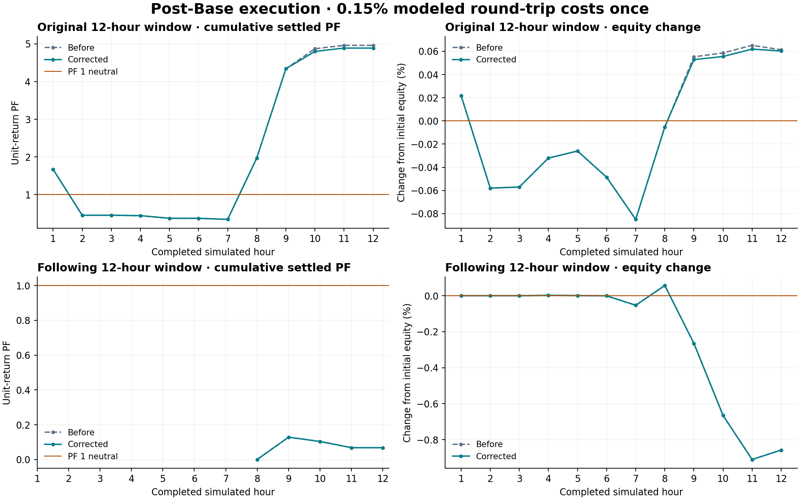

# Signal post-Base admission and PF verification

The shared Signal direction and loss-cluster gates now consume settled accepted post-Base modeled orders. Rejected candidates and unproven legacy admissions cannot veto or qualify that shared record. Each config's own historical validation still retains its candidate losses, and the explicit raw engine-direction diagnostic remains separate. Existing PF thresholds, minimum samples and windows are unchanged. Settings now describe these scopes.

The exact same orders retain the exact same returns and PF. The repair allows additional validated orders; a changed executed cohort can have a different PF. Historical qualification PF and later realized PF are different samples. PF **1 is neutral**, and the modeled **0.15% round-trip cost is retained once**.

## Two complete native replays

Both use the same frozen settings and public candles before/after: 12 symbols, 150h Signal history, Last-4, 1/5/15-minute indication lanes, minute prices, Signals protection grid plus independent Exit. These are reused retrospective windows, not unseen forward evidence or exchange fills.

| UTC trading window | Settled PF before → corrected | Orders opened / settled / held | Positions opened / closed / held | Peak equity loss DD | Ending equity change | Positive / negative / flat settled hours |
|---|---:|---|---|---:|---:|---|
| Oct 16 21:00–Oct 17 09:00 | 4.961150 → 4.888011 | 476 / 371 / 105 | 15 / 6 / 9 | 0.1316% | +0.0603% | 5 / 5 / 2 |
| Oct 17 09:00–21:00 | 0.067947 → 0.067947 | 860 / 278 / 582 | 4 / 2 / 2 | 1.1700% | −0.8572% | 0 / 4 / 8 |

In the first window all 366 original closes remain, with unchanged returns and common-cohort PF 4.9611495582. Five additional closes produce the combined PF 4.8880110081; none of the original losses is removed. The later window retains all 278 closes unchanged, including its losses. Open endpoint marks remain outside settled PF.

The first seven later-window hours have no settled finite PF and are left blank. Equity includes open P&L. The hourly report does not replace minute calculation or decision clocks.

## Coverage and speed

| Measure | Original window | Following window |
|---|---:|---:|
| Sources / source-lane combinations | 118 / 663 | 118 / 663 |
| Configs built | 126,249 | 126,289 |
| Historical closes | 10,764,881 | 10,999,508 |
| Missing configured cells | 0 | 0 |
| Settled returns exactly matched to source | 371 / 371 | 278 / 278 |
| Independent scalar comparisons | 39,389,688 | 39,402,168 |
| Native report checks passed | 68 / 68 | 68 / 68 |
| Computation seconds | 499.904 | 519.572 |
| Native run and export seconds | 529.493 | 549.643 |
| Independent history audit seconds | 78.228 | 79.049 |
| Peak child RSS MiB | 3,522.6 | 3,491.1 |

All frozen inputs, own-history qualification, hourly selections and per-group protection inventories compare equal before/after. Every primary allocation is known; both position and order ledgers conserve opened = closed/settled + held. Host-dependent native times do not establish a controlled historical-calculation speedup.

The exact-lane database promotion benchmark uses 100,000 rows and 20 changed revisions. All 20 admission verdicts/PFs match the full reader. Median lookup is 0.353ms, maximum 0.864ms, versus a 237.406ms median full-book read. This is a synthetic database benchmark, not exchange order latency. A native-adapter fixture also opens a qualified lane while asynchronous income-history loading is pending and rejects its losing sibling.

CI for `f2a52dd2f162926ababce6fa46a35b89be9d6c1d` passes all seven jobs: 4,350 tests, no failures/cancellations, eight template exclusions; the two ordinary slow-test exclusions pass separately. Quality includes actual browser, settings save/reload, production build, types and lint. The initial stale raw-direction fixture failure and its repair are retained. Economic source for both replays and this tested correction is `9ac49d0c8c5daeca5942e90f5100169ff0382afdc57e5268729054878b7cfee1`.

## Remaining limits

- Forward profitability is not stable: the later window is below PF 1. No X02 trading, live settings change or live reload was performed. The user's stability condition for unrestricted VST execution is not met.
- In the later control, five own-activation-ready candidate observations remain outside the earlier hourly selection snapshot. Global selection, shared risk and funding eligibility have not established that they are missing funded orders. No selection-clock repair is claimed.
- The earlier all-range ordinary hold-0 run timed out at 10,800s while Base was 76% complete. Hold-15 aborted during tape construction after RSS reached 14,143MB and available memory fell below the guard. Neither is a completed simulation or profitability result. The separate eight-arm ordinary recovery study remains incomplete.
- All ten earlier DCA/Block Signal arms completed on economic source `9a088c4…`; their later-window PFs were 0.064–0.068. Only the two controls were rerun for this shared-feedback repair. Those older arms are not evidence for the new revision's DCA/Block economics. Fractional Exit scale-outs also remain incomplete.

## Detailed evidence

- [All current per-type/range/lane rows, Last-4 readiness, SL/TP ratios, trail distances, DDT and twelve hourly rows](current-controls/RESULTS.md)
- [Complete current source/symbol/config-group data](current-controls/financial-results.json.gz)
- [Before/after frozen input and qualification comparison](comparison.json)
- [Original-window common order proof](common-orders-control-0.json) and [later-window common order proof](common-orders-control-12.json)
- [CI evidence](verification-f2a52dd.json) and [database benchmark](promotion-benchmark.json)
- [All ten earlier recovery outcomes, including losses](../recovery-live-accounting-20261025/complete-9a088/RESULTS.md)

The report distinguishes a verified software correction from a production profitability certificate. Full raw replay evidence is preserved separately; PR #200 records the release/merge state.
